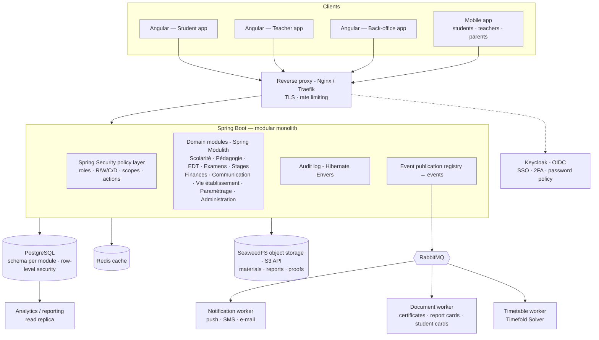

# Tekup · Educated — Roles & Functionalities

**Platform:** Educated 7.0 (Tekup / TEK-UP University of Digital Sciences)
**Survey date:** 17 November 2026 · academic year 2026-2027 (student portal still shows 2025-2026)
**Method:** read-only walkthrough of every menu, screen, tab, toolbar and form. I opened forms to read their fields and closed them without saving. Nothing was created, edited, sent or deleted.

> **How to read the action lists:** for the back-office screens I list the **buttons the account is shown** on each screen. A visible button usually means the role has that permission. I didn't click any of them, so the server could still refuse an action.

---

## 1. Overview — portals and roles

| Portal | URL | Who uses it | Status |
|---|---|---|---|
| **Espace étudiant**<br>(Student space) | `tekup-student`<br>`.educated.tn/etudiant/` | Students<br>(same login as mobile app) | ✅ Fully explored |
| **Espace enseignant**<br>(Teacher space) | `tekup-teacher`<br>`.educated.tn/enseignant/` | Teachers<br>(same login everywhere) | ✅ Fully explored |
| **Espace de gestion**<br>(Back-office) | `tekup.educated.tn` | Administrative staff,<br>access set by role | ✅ Explored with<br>role **"Scolarité"** |
| Mobile app "Educated" | — | Students, teachers,<br>**parents/guardians** | ❌ Not available |
| Admin / Super Admin | `tekup.educated.tn` | Platform administrators | ❌ No login yet.<br>See §5 |

### Role map

```
Students ........... Espace étudiant + mobile app     (fixed role)
Teachers ........... Espace enseignant + mobile app   (fixed role)
Parents/Guardians .. mobile app only                  (logins made by staff)
Back-office staff .. Espace de gestion                (CONFIGURABLE roles)
   ├─ Super Admin .. administrative: bypasses all permissions, builds roles
   ├─ Admin ........ users & profiles (Administration module)
   ├─ Scolarité .... role tested here (21 users, "Allow all by default")
   └─ custom roles . Direction, Pédagogie, Examens, Finances, or bespoke
```

> Student and teacher portals have **fixed** feature sets (sections 2 and 3). Fine-grained, configurable access applies to the **back-office**, where the Super Admin defines each role (see §5).

---

## 2. STUDENT — Espace étudiant

Login: student ID + password (same as the Educated mobile app). Forgotten password → handled by the scolarité (registrar's office). There is no self-service reset.

### 2.1 Global features (header and account)
| Feature | What it does |
|---|---|
| **Search (Ctrl K)** | Searches course materials, exams, messages,<br>and jumps to any section |
| **Light/dark mode toggle** | Switches the theme |
| **Notifications bell** | Unread count, links to the Notifications page |
| **Profile (name in header)** | Opens *Mon profil* |
| **Mobile bottom bar** | Accueil · Agenda · Notes · Messages · Plus |

### 2.2 Accueil (Home)
- Date, week number, semester, greeting.
- **Today's classes**, or "Pas de cours aujourd'hui" when there are none.
- **"Ma semaine"** stats: sessions completed, absences, materials posted, unread messages (scolarité and discussions), exams this week.
- **À faire** (to-do list), e.g. "Vous êtes à jour".
- **Prochain examen** (next published exam) with a link to the calendar.
- **Nouveau depuis 7 jours**: recent news.
- Shortcuts: **Ma carte étudiant** (student card), **Écrire à la scolarité** (write to the registrar).

### 2.3 Ma scolarité (My studies)
| Section | View | Actions |
|---|---|---|
| **Emploi du temps**<br>(Timetable) | Class timetable.<br>Flags sessions where<br>the teacher is absent | Previous/next week, Today<br>Week / Day / List views<br>Compact mode |
| **Supports et programmes**<br>(Materials & programs) | Course materials posted<br>by teachers, and<br>course programs | Switch tabs<br>Open / download |
| **Notes**<br>(Grades) | Published grades by period | Choose a semester (S1 / S2) |
| **Examens**<br>(Exams) | Published exams by period.<br>The room appears once<br>it is published | Choose a semester |
| **Absences** | Sessions missed, hours missed,<br>subjects affected, subjects at risk.<br>Rate per subject:<br>**at risk ≥ 10 %, critical ≥ 25 %**.<br>Only calls confirmed by the<br>teacher count. Sessions where<br>the teacher was absent don't | Justify an absence by<br>messaging the scolarité<br>with proof |
| **Mon stage**<br>(My internship) | Title, number, year, company,<br>dates, academic and<br>professional supervisors.<br>**Timeline:** En cours d'approbation<br>→ Approuvé → Demande de<br>soutenance → Autorisé par<br>l'encadrant → Autorisé à soutenir.<br>**Defense:** date, time, room,<br>session, jury (Président /<br>Rapporteur / Membre).<br>Previous internships (Validé) | **Ajouter un stage**<br>(declare an internship)<br>**Upload** the report and<br>the certificate (they lock<br>once the defense<br>is authorized)<br>**Télécharger** (download)<br>**Request a defense**<br>in a session |

### 2.4 Échanges (Communication)
| Section | What the student can do |
|---|---|
| **Messages**<br>(with the scolarité) | Inbox and sent items, search.<br>**Écrire à la scolarité**: subject*, message,<br>optional attachment (≤ 20 MB) |
| **Discussions** | Chat with **teachers and classmates**:<br>*Nouvelle conversation* |
| **Notifications** | All / Unread. Opening a notification marks it read<br>and opens the related item. Same notifications<br>as the mobile app |
| **Actualités** (News) | School announcements and events<br>(elections, open days, courses…), with attachments |

### 2.5 Démarches (Procedures)
| Section | What the student can do |
|---|---|
| **Demandes de documents**<br>(Document requests) | **Nouvelle demande**: choose a document, add a reason,<br>optional proof file (PDF/JPG/PNG ≤ 5 MB).<br>Status: **Déposée** (submitted) → **En traitement**<br>(in progress) → **Traitée** (ready, collect it<br>at the scolarité) |
| Documents available | • Attestation d'inscription (enrollment): EN / AR / FR<br>• Attestation de présence (attendance): EN / AR / FR<br>• Attestation de paiement (payment): EN / FR<br>• Attestation de diplôme (diploma)<br>• Attestation de réussite (pass certificate)<br>• Relevé des notes (transcript) |
| **Paiements**<br>(Payments) | **Disabled** ("Cette rubrique est<br>actuellement désactivée") |

### 2.6 Mon profil (Account and profile)
- **Student card** for the current year: name, student number, program, level, class. **Print or save as PDF**. A QR verification code is announced as "coming later".
- **Mes informations**: name, student number, program, level, class, login ID, establishment. **Read-only**: errors must be reported to the scolarité.
- **Apparence**: System / Light / Dark.
- **Changer de mot de passe**: current password, new password (≥ 6 characters), confirmation. It also changes the mobile app password.
- **Se déconnecter** (log out).

---

## 3. TEACHER — Espace enseignant

Login: same ID as the management portal and the mobile app. Forgotten password → scolarité.

### 3.1 Global features (header and account)
| Feature | What it does |
|---|---|
| Light/dark mode toggle | Theme |
| **Notifications bell** | Unread count, links to the Notifications page |
| Name and **Se déconnecter** | Log out |
| ⚠️ **No profile or<br>password page** | `/enseignant/profil` returns "Cette page n'existe pas".<br>The web teacher portal offers no password change |

### 3.2 Accueil (Home)
- **Today's timeline**: each session with its call status ("4 / 4 appels faits").
- **Today's sessions** (subject, class, room, type) with **Voir l'appel** (view the call).
- **Stages et soutenances** summary: internships supervised, reports submitted, **subjects to approve**, **defenses to authorize**, next jury (date, room, role, number of defenses).
- **À faire**: grade grids open, unread messages (including from the administration).
- **Prochaines surveillances** (upcoming exam supervision).
- **Messages** preview.
- Shortcuts: **Déposer un support** (upload material), **Écrire à l'administration** (write to the administration).

### 3.3 Mon travail (My work)
| Section | View | Actions |
|---|---|---|
| **Emploi du temps**<br>(Timetable) | Week view of every session,<br>with totals (sessions, hours,<br>calls to do) and status per<br>session (Appel fait /<br>Non confirmé) | Filter by class<br>Week / List view<br>Compact mode<br>Previous/next week |
| **Appels**<br>(Attendance calls) | Last 14 days:<br>• **À faire** (to do)<br>• **Délai dépassé** (deadline<br>passed: contact the scolarité)<br>• **Faits** (done) | Mark each student<br>**Présent / Absent / Retard**<br>(present, absent, late),<br>then confirm.<br>**Modifier l'appel** (edit)<br>until a deadline,<br>about the next day |
| **Supports de cours**<br>(Course materials) | Every subject/class taught,<br>with the number of<br>materials for each | **Déposer un support**:<br>title*, type (Cours, DS,<br>Examen, Projet, Quiz,<br>TD, TP), description,<br>file (≤ 50 MB) |
| **Saisie des notes**<br>(Grade entry) | Grade grids per subject ×<br>class × assessment<br>(Projet, Test, PFE…), with<br>grids to fill and<br>missing grades | **Grade out of 20** or a<br>**reason**: Absence justifiée,<br>Absence non justifiée,<br>Dispensé(e), Fraude.<br>**Enregistrer** (save draft)<br>**Confirmer la grille** (finalize) |
| **Stages et soutenances**<br>(Internships & defenses) | **Mes stagiaires**: by session,<br>year and status (À traiter,<br>En cours, Autorisés, Refusés).<br>Detail: subject, company,<br>supervisor, dates, objectives,<br>report status | **Approve the subject**<br>**Authorize the defense**<br>(these appear on items<br>in "À traiter") |
| | **Mes jurys**: each jury<br>(date, room, role), its<br>defenses and the final grade<br>once validated | **View only**: the scolarité<br>enters and publishes<br>defense grades |
| **Surveillances**<br>(Exam supervision) | Upcoming supervision duties.<br>Only plannings published<br>by the scolarité appear | Show past supervisions |
| **Messages** | **Établissement**: inbox and sent<br>messages with the administration.<br>**Conversations**: chats with<br>students and colleagues | **Écrire à l'administration** |
| **Notifications** | Filters: Toutes, Non lues,<br>Appels, Stages, Surveillances,<br>Établissement, Conversations,<br>Autres | **Tout marquer comme lu**<br>(mark all read), Ouvrir.<br>Synced with mobile |

---

## 4. BACK-OFFICE STAFF — Espace de gestion (role "Scolarité")

The account tested on `tekup.educated.tn` holds the role **"Scolarité"**. This is one configured role, not a fixed one: what follows is what **this role's configuration** allows. Its actual settings, read from the role editor:

| Setting | Value for "Scolarité" |
|---|---|
| Is Administrative /<br>Can Edit Model | No / No |
| **Permission Policy** | **Allow all by default**<br>(anything not explicitly denied is allowed) |
| **Modules visibles**<br>(6 of 10) | ✅ Scolarité, Pédagogie, Emplois du temps, Stages,<br>Vie de l'établissement, Communication<br>❌ Examens et notes, Finances, Paramétrage,<br>Administration |
| **Type permissions**<br>(explicit rules) | **Delete = Deny** on Cycle, Site, Nature de stage,<br>Filière, Emploi de temps, Apprenant, Programme<br>des séances, Enseignant, Plan d'étude, Niveau, Classe<br>**Read = Allow** on Fiche de présence<br>**Write = Allow** on Plan d'étude |
| **Navigation permissions**<br>(menus denied) | Administration, Cantine, Contrôle d'accès, Evaluation,<br>Billets d'entrée, Opérations billets d'entrée, Exclus,<br>Infirmerie, Fiches de présence, Paiements |
| **Denied actions** | "Passer en mode conception" (switch to design mode) |
| Users with this role | 21 accounts, including several teaching staff |

Because the policy is *Allow all by default* with only a few explicit denials, this role reaches the 5 business modules below and sees create and edit buttons almost everywhere. Delete is blocked on the core reference data listed above.

Login: user name + password + **2FA verification code** (the login page has a 2FA field).

### 4.1 Global features (header, account and settings)
| Feature | What it does |
|---|---|
| **Module switcher**<br>(top-left) | Recent records, switch module (each with an alert<br>count), search screens or learners |
| **Global search (Ctrl K)** | "Rechercher partout dans Educated…"<br>(search all of Educated) |
| **Academic year selector** | Switch the working year (e.g. 2026-2027) |
| **Establishment selector** | "TEK-UP": switch the establishment |
| **Notifications bell** | Toutes / Non lues, **Tout marquer comme lu**,<br>*Voir toutes les notifications*, **Réglages** |
| **Mes notifications** page | Filters: Toutes, Non lues, **Points d'attention,<br>Demandes, Messages reçus, Actualités**.<br>**Settings**: turn each type on or off. E-mail<br>delivery is "à venir" (coming).<br>**Do-not-disturb** (off / on / daily time range) |
| **Settings gear** | Display **size mode** (Compact…) |
| **Mon compte →<br>Mes informations** | Own user record: 2FA activé, Force Password Change,<br>User Name, Is Active. Tabs: *Message From Users*,<br>*Message To Users*, *Roles*.<br>Buttons: **Enregistrer**, **Activer le 2FA**,<br>**Changer mon mot de passe** |
| **Mon compte →<br>Se déconnecter** | Log out |
| **Favourites** | Pin any menu screen with ☆ |
| **Chat bubble**<br>(bottom-right) | Internal staff discussions |
| **Every list screen** | Filters, group-by, column chooser,<br>**🤖 Recherche intelligente** (AI smart search),<br>text search, **Exporter vers** (CSV…),<br>refresh, record navigation |

### 4.2 Accueil — Tableau de bord (Home dashboard)
- "*Bonjour …, N points à traiter*" (N items to handle), filterable by **à traiter / critiques / à surveiller / infos**, with a **Commencer** button that walks through them in order.
- Status cards per area: Scolarité, Pédagogie, Emplois du temps, Stages, Vie de l'établissement, Communication.
- KPIs on the day of the snapshot: **active learners** (2,985 in 102 classes), **active teachers** (182), **absence rate** (33.8 % against a 25 % threshold), **calls done** (94 %).
- **Today's** issues: sessions without a teacher, calls not done, room conflicts, pre-registrations to review, sessions done awaiting validation, cancelled sessions with no make-up, internship requests to approve, reports not submitted, students above 25 % absence, absent students whose parents weren't notified, make-up requests, sessions without a teacher or room, pending document requests, unread messages from teachers and learners.

### 4.3 Module SCOLARITÉ (Student records)
| Screen | Actions visible |
|---|---|
| Tableau de bord | Module dashboard |
| **Apprenants →**<br>Apprenants actifs /<br>Liste détaillée /<br>Tous les apprenants | **New learner**, Print/Reports (incl. **"Accès Etudiant"**<br>login sheet), **Export CSV**, **Inscription** (enroll),<br>**Tarification** (fees for one learner),<br>**Historique d'affectation** (class history),<br>**Message to parents**, **Message to learners**, Process |
| **Apprenants →**<br>Responsables<br>(parents/guardians) | Create / edit / delete, **Corriger GSM** (fix phones),<br>**Générer login et mot de passe** (parent app accounts),<br>**Message to guardians**, Vue, Process |
| **Apprenants →**<br>Fratries (siblings) | Edit, delete |
| **Apprenants →**<br>Liens de parenté | Create / edit / delete<br>(relationship types: Père, Mère, Tuteur…) |
| **Inscriptions →**<br>Demandes de<br>préinscription | Create / edit / delete,<br>**Valider préinscription** (approve), Process |
| **Inscriptions →**<br>Historique d'affectation | Create / edit / delete (class assignments) |
| **Assiduité →**<br>Pilotage des absences<br>(absence dashboard) | Period: week / month / semester / year / dates.<br>Filters: level, class, subject, type.<br>KPIs: absence rate, learners above 25 %, class ×<br>subject pairs above it, late arrivals, call reliability.<br>Weekly trend, by level, by class, learners above<br>the threshold with a **Récap**. **Exporter** |
| **Assiduité →**<br>Absences | Create / edit / delete, Print / Reports, **Export CSV**<br>(attendance lines grouped by date, time, class) |
| **Assiduité →**<br>Demandes d'absence | Create / edit / delete, Export CSV |
| **Assiduité →**<br>Sanctions | Create / edit / delete, **Envoyer notification**, Process |
| **Demandes de documents** | New request, **Changer le statut**<br>(Ouvert → … → Traité), edit. No delete |
| **Éditions →**<br>Registres (présence /<br>inscription) | Create / edit / delete<br>(print logs for attendance and enrollment sheets) |

### 4.4 Module PÉDAGOGIE (Teaching)
| Screen | Actions visible |
|---|---|
| Tableau de bord | Module dashboard |
| **Plans d'étude**<br>(study plans, 52) | Create / clone / edit. Process:<br>**Générer bulletin des notes** (report cards),<br>**Valider affectations**, **Générer fiches de notes**,<br>**Générer affectation des appréciations**,<br>**Générer grilles de décisions de classes** |
| **Matières** (subjects) | Create / edit / delete |
| **Enseignants →**<br>Enseignants (182) | Create, edit, **Envoyer l'accès par e-mail**,<br>Print / Reports, **Générer fiche de vœux**<br>(matière / emploi du temps), **Générer rapport<br>de présence**, **Générer login et mot de passe**,<br>*Inverser nom et prénom*, **Envoie un message**.<br>No delete |
| **Enseignants →**<br>Fiches de charge | Create / clone / edit / delete,<br>**Générer grille de saisie** (grade-entry grids), Process |
| **Enseignants →**<br>Répartition des matières | Create / edit / delete |
| **Enseignants →**<br>Vœux matières /<br>Vœux emploi du temps | Create / edit / delete (preferences) |
| **Enseignants →**<br>Spécialités | Create / edit / delete |
| **Suivi des cours →**<br>Présence des enseignants | Create / edit / delete, **Payer**, **Annuler paiements**<br>(teacher hours payment) |
| **Suivi des cours →**<br>États d'avancement | Create / edit / delete (course progress) |
| **Suivi des cours →**<br>Programmes<br>d'enseignement | Create / **clone** / edit / delete |
| **Suivi des cours →**<br>Cahier de texte | Create / edit / delete,<br>**Opérations → Confirmer cahier de textes** |
| **Suivi des cours →**<br>Devoirs (homework) | Create / edit / delete, **Opérations → Confirmer** |
| **Suivi des cours →**<br>Supports de cours | Create / edit / delete |
| **Suivi des cours →**<br>Charge par matière | Create / clone / edit / delete<br>(teacher assignment per subject) |
| **Demandes →**<br>Séances de rattrapage | Create / edit / delete,<br>**Process → Opérations → Confirmer** (make-ups) |
| **Demandes →**<br>Rendez-vous | Create / edit / delete (meetings with teachers) |
| **Demandes →**<br>Créneaux de rendez-vous | Create / edit / delete (teacher meeting slots) |
| **Observations** | Create / edit / delete (observation log) |
| **Formation continue** | Create / edit / delete (continuing education) |

### 4.5 Module EMPLOIS DU TEMPS (Timetables)
| Screen | Actions visible |
|---|---|
| Tableau de bord | Module dashboard |
| **Emplois du temps** | Create, Print / Reports, **Export**,<br>**Générer (Optimisé)** (automatic timetable),<br>open the planner, Process |
| **Contrôle des créneaux**<br>(slot control) | Slots to fix: **room conflicts**, **no teacher**,<br>**no room**, *hors contrôle* (excluded).<br>Group by class, teacher or room. Week or all.<br>Fixes: **move** a slot, **change the room**,<br>**mark "hors contrôle"**. Open in calendar |
| **Programmes des séances** | Create |
| **Règles pédagogiques** | Create / edit / delete (scheduling rules) |
| **Calendrier universitaire** | Create / edit / delete, **Exporter calendrier**, Process |

### 4.6 Module STAGES (Internships)
| Screen | Actions visible |
|---|---|
| Tableau de bord | Module dashboard |
| **Demandes de stage**<br>(internship requests) | Create, delete, **Approuver**, **Refuser**,<br>**Autoriser par l'encadrant**, **Autoriser à soutenir**,<br>**Rouvrir le dossier** (reopen),<br>**Rattacher l'encadrant** (attach a supervisor),<br>edit, Print / Reports |
| **Soutenances** (defenses) | Create / edit / delete, **Publier / Dépublier**,<br>**Valider la note** (validate grade), Print / Reports |
| **Jurys** | Create / edit / delete, Print / Reports |
| **Sessions de soutenance** | Create / edit / delete, Print / Reports |
| **Entreprises d'accueil**<br>(host companies, 989) | Create / edit / delete |
| **Encadrants<br>professionnels** | Create / edit / delete (company supervisors) |

### 4.7 Module COMMUNICATION
| Screen | What it does |
|---|---|
| Tableau de bord | Module dashboard |
| **Messages reçus** (inbox) | Messages from **learners, parents and teachers**<br>(last 90 days), filter by audience, unread only, search |
| **Messages envoyés** | Sent messages |
| **Nouveau message** | Audience: **Apprenants / Parents / Enseignants**.<br>Recipients: individuals or groups (**all**, **by level**,<br>**by class**). Subject, rich-text body, push/SMS text<br>(160 chars). Send as **app notification**, **SMS**,<br>optionally **also notify parents**. **Attach a file** |
| **Discussions internes** | Staff-only chat: **Nouvelle** (colleague or group) |
| **Mes notifications** | See §4.1 |
| **Chat enseignants –<br>apprenants** | Create / edit / delete<br>(moderation of teacher–learner conversations) |
| **Actualités** (news) | **Nouvelle actualité**: publish to the learner, parent<br>and teacher apps. Filter: notified / not yet notified |
| **Notifications envoyées**<br>(push analytics) | Volume, recipients and **read rate** by period,<br>audience and type (Absence, Message, Actualité,<br>Document, Discussion). Daily chart. Recipients<br>without the app installed |
| **Demandes des<br>responsables** | Create / edit / delete<br>(*Prise RDV*: parent appointment requests) |

---

## 5. SUPER ADMIN & CONFIGURABLE ROLES (the role builder)

Back-office roles are not fixed. The **Super Admin** creates roles and decides, for each one, which sections are visible and which actions are allowed: read only, read and write, full control, or hidden. The "Scolarité" role in §4 is one such role.

> The role editor below was **read directly** from the "Scolarité" role record (opened from *Mon compte → Mes informations → Roles*). I changed nothing and didn't save. The Super Admin's own screens (role list, Administration module) haven't been seen yet, so those parts are marked *(to verify)*.

### 5.1 What the Super Admin does
| Area | Capabilities |
|---|---|
| **Roles (profils)** | Create (*Nouveau Role*), edit, clone, delete roles.<br>Set modules, default policy, per-entity rights,<br>per-menu access and denied actions (§5.2) |
| **Users** | Create users, link/unlink them to roles (*Lier / Dissocier*),<br>activate/deactivate, force a password change,<br>enable 2FA (*Activer le 2FA*) |
| **Administrative flag** | *Is Administrative*: full access that **bypasses all<br>permissions** ("Permissions are customizable and<br>apply only to non-Administrative roles") |
| **Model editing** | *Can Edit Model*: customize the application itself<br>(layouts, views, *Passer en mode conception*) |
| **Paramétrage**<br>*(to verify)* | Reference data: cycles, sites, filières, niveaux,<br>classes, natures de stage… |
| **Administration**<br>*(to verify)* | "utilisateurs, profils, système"<br>(users, profiles, system) |
| **Multi-establishment**<br>*(to verify)* | Establishment selector (TEK-UP) in the header:<br>a Super Admin likely spans several establishments |

**Admin vs Super Admin** *(to verify)*: the Super Admin is most likely an *Is Administrative + Can Edit Model* role. An Admin is either administrative without model editing, or a non-administrative role given the Administration module to manage users and profiles.

### 5.2 Anatomy of a role (as seen in the role editor)

A role has 6 layers. Visibility (layer 2) and data access (layers 3 to 6) are **separate**: the editor states "*Ce choix règle ce que les utilisateurs du profil voient. L'accès aux données reste celui des permissions ci-dessous*" (this choice sets what users see; data access remains whatever the permissions below allow).

| # | Layer | What it controls | Options |
|---|---|---|---|
| 1 | **Identity** | Name, *Is Administrative*,<br>*Can Edit Model* | Text, checkboxes |
| 2 | **Modules<br>visibles** | Which of the 10 modules<br>appear in menu, home, alerts | On/off per module.<br>Presets: **Direction, Scolarité,<br>Pédagogie, Examens, Finances** |
| 3 | **Permission<br>Policy** | Default for everything<br>not listed | **Deny all** / **Read only all** /<br>**Allow all** by default |
| 4 | **Type<br>Permissions** | Rights on each entity<br>(Apprenant, Classe…) | **Read / Write / Create / Delete**:<br>*Allow*, *Deny* or blank (inherit) |
| 5 | **Navigation<br>Permissions** | Access to each menu entry | **Navigate**: *Allow* / *Deny* |
| 6 | **Denied<br>Actions** | Hide specific buttons even<br>where data is allowed | e.g. *Payer*, *Valider la note*,<br>*Publier*, *Supprimer* |
| + | **Users** | Who holds the role. Rights<br>of several roles combine | Link / unlink users<br>*(combination rule to verify)* |

*(to verify)* The underlying framework (DevExpress XAF, judging by the screen names) also supports **object-level permissions** (e.g. "only classes of my department") and **field-level permissions** (e.g. "can see a learner but not their fees") inside each type permission. Open a type-permission row as Super Admin to confirm.

### 5.3 The 10 modules a role can be given
| Module | Covers (editor's description) | Seen in this survey |
|---|---|---|
| Scolarité | inscriptions, apprenants, assiduité | §4.3 |
| Pédagogie | plans d'étude, séances, appels | §4.4 |
| Emplois du temps | créneaux, salles, conflits | §4.5 |
| **Examens et notes** | sessions, grilles, bulletins | ❌ not enabled |
| Stages | demandes, conventions, soutenances | §4.6 |
| **Finances** | échéances, paiements, relances | ❌ not enabled |
| Vie de l'établissement | actualités, sondages, services | dashboard card only |
| Communication | messages, actualités, notifications | §4.7 |
| **Paramétrage** | référentiels de l'établissement | ❌ not enabled |
| **Administration** | utilisateurs, profils, système | ❌ not enabled |

The navigation-permission list also shows **further screens** that exist in the platform and can be granted or denied per role: **Cantine** (canteen), **Contrôle d'accès** (access control), **Billets d'entrée / Opérations billets d'entrée** (entry tickets), **Exclus** (excluded students), **Infirmerie** (infirmary), **Evaluation**, **Fiches de présence**, **Paiements**.

### 5.4 How to build each kind of access
| Access you want | How to configure it |
|---|---|
| **Hidden** | Module off + *Navigate = Deny* on its screens and,<br>if the policy isn't Deny-all, *Read = Deny* on its<br>entities. Hiding the menu alone doesn't block data |
| **Read-only** | *Read = Allow*, *Write / Create / Delete = Deny*.<br>Or policy **Read only all by default** + grant<br>writes only where needed |
| **Read + edit,<br>no create/delete** | *Read / Write = Allow*, *Create / Delete = Deny* |
| **Full control** | *Read / Write / Create / Delete = Allow* |
| **Everything except<br>one sensitive action** | Allow the data + add the button to **Denied Actions**<br>(e.g. *Payer*, *Valider la note*, *Publier*) |
| **Only their own scope**<br>*(to verify)* | Object-level criteria (department, class, site) |
| **Hide sensitive fields**<br>*(to verify)* | Field-level permission (fees, phone numbers…) |

> **Good practice:** start every non-admin role from **Deny all by default** and grant explicitly (least privilege). The current "Scolarité" role does the opposite (*Allow all by default*), which is why it can do far more than its name suggests.

### 5.5 Typical roles (proposed set)
The 5 presets exist in the editor. Their exact permissions weren't visible, so the rights below are a **recommended** baseline, not what is configured today.

| Role | Modules visible | Data rights (recommended) |
|---|---|---|
| **Super Admin** | All 10 | *Is Administrative* + *Can Edit Model* |
| **Admin** | Administration,<br>Paramétrage +<br>read on the rest | Full on users, roles, reference data.<br>Read-only on business data.<br>Can't edit the model |
| **Direction**<br>(preset) | All business modules | **Read only all by default**,<br>plus dashboards and exports |
| **Scolarité**<br>(preset, exists) | Scolarité,<br>Communication,<br>Stages (read) | Full on learners, guardians, enrollment,<br>absences, sanctions, document requests.<br>Read on Pédagogie / timetables.<br>Deny *Payer*, *Tarification* |
| **Pédagogie**<br>(preset) | Pédagogie,<br>Emplois du temps | Full on study plans, teachers, workloads,<br>course follow-up, make-ups.<br>Read on learners. Deny teacher *Payer* |
| **Examens**<br>(preset) | Examens et notes,<br>Stages (defenses) | Full on exam sessions, grids, report cards,<br>defense grades. Only role with<br>*Valider la note* and *Publier* |
| **Finances**<br>(preset) | Finances,<br>Scolarité (read) | Full on fees, payments, reminders,<br>teacher hours payment. Only role with<br>*Payer* and *Annuler paiements* |
| **Bureau des stages**<br>(custom example) | Stages,<br>Scolarité (read) | Full on internships, juries, sessions,<br>companies, supervisors |
| **Communication**<br>(custom example) | Communication | Full on news, bulk messages and SMS.<br>Read on learners and guardians |
| **Auditeur**<br>(custom example) | All | **Read only all by default**.<br>Deny every write action |

### 5.6 Permission matrix template
Fill one column per role (R = read, W = write/edit, C = create, D = delete, — = hidden). Example values for a read-only "Direction" role and the current "Scolarité" role:

| Section / entity | Direction<br>(proposed) | Scolarité<br>(current) | New role |
|---|---|---|---|
| Apprenants | R | R W C — (no D) | |
| Responsables (guardians) | R | R W C D | |
| Inscriptions / préinscriptions | R | R W C D | |
| Absences / fiches de présence | R | R W C D ¹ | |
| Sanctions | R | R W C D | |
| Demandes de documents | R | R W C | |
| Plans d'étude | R | R W C — | |
| Enseignants | R | R W C — | |
| Présence & paie enseignants | R | R W C D + *Payer* | |
| Emplois du temps | R | R W C — | |
| Examens et notes | R | hidden, data<br>allowed ² ⚠️ | |
| Stages / soutenances | R | R W C D | |
| Finances | R | hidden, data<br>allowed ² ⚠️ | |
| Communication | R | R W C D | |
| Paramétrage (reference data) | — | partly, no D ³ | |
| Administration (users, roles) | — | — ⚠️ see §7.2 | |

¹ Read is allowed explicitly and the rest comes from the policy. The "Fiches de présence" menu is denied.
² The module is hidden (and the "Paiements" menu denied), but the "Allow all" policy still allows the data.
³ Delete is denied on reference entities (Cycle, Site, Filière, Niveau, Classe…).

### 5.7 Non-staff roles
| Role | Functions | Evidence |
|---|---|---|
| **Parent / Guardian**<br>(mobile app) | Receives absence alerts,<br>messages, news. Writes to<br>the school. **Books<br>appointments** with teachers | Guardian login generation,<br>*Prévenir aussi les parents*,<br>*Demandes des responsables*,<br>*Créneaux de rendez-vous* |
| **Company supervisor**<br>(encadrant professionnel) | Stored as data on<br>internships. No portal seen | *Encadrants professionnels*<br>list |

---

## 6. Cross-role workflows

The "Back-office" column describes what the back-office side of each process involves. Which staff role performs each step depends on how the Super Admin configures roles (§5).

| Process | Student | Teacher | Back-office |
|---|---|---|---|
| **Attendance** | Sees absences<br>and rates per subject.<br>Justifies by message | Takes the call<br>(Present / Absent / Late)<br>and confirms. Can edit<br>until the deadline | Absence dashboard,<br>calls not done,<br>absence requests,<br>notifies parents |
| **Grades** | Sees published<br>grades per semester | Fills the grids<br>(grade or reason),<br>saves, **confirms** | Generates grids,<br>report cards and<br>class decision grids |
| **Course materials** | Views, downloads | Uploads (≤ 50 MB) | Manages materials<br>and programs |
| **Internship / PFE** | Declares it, uploads<br>report + certificate,<br>requests a defense,<br>sees jury and date | Approves the subject,<br>authorizes the defense,<br>sits on juries<br>(view only) | Approves / refuses,<br>builds juries and<br>sessions, **enters,<br>validates, publishes<br>defense grades** |
| **Document requests** | Requests one of<br>11 documents,<br>tracks status | — | Changes the status<br>(Ouvert → Traité) |
| **Timetable** | Views it | Views it, call<br>status per session | Generates (optimized),<br>fixes conflicts,<br>rules, calendar |
| **Make-up sessions** | — | Requests make-ups | Confirms them |
| **Exam supervision** | Sees exams and<br>rooms once published | Sees duties<br>once published | Publishes plannings |
| **Messaging** | Messages the scolarité,<br>chats with teachers<br>and classmates | Messages the<br>administration, chats | Bulk messages, SMS,<br>push, news,<br>push analytics |

---

## 7. Observations and points to verify

1. **The "Scolarité" role is over-permissive by configuration.** Its policy is *Allow all by default* with only 11 delete denials, so it can create and edit almost everything, including teacher hours payment (*Payer*) and generating logins for teachers and parents. Hiding a module (Examens, Finances) only hides the menu. **Fix:** switch to *Deny all by default* or *Read only all by default* and grant explicitly.
2. **⚠️ Possible privilege escalation (high priority to verify).** From *Mon compte → Mes informations → Roles*, the Scolarité account can **open its own role's editor**. It's shown **Enregistrer, Supprimer, Nouveau Role, Lier / Dissocier users**, the *Is Administrative* checkbox and the policy selector, even though the "Administration" menu is denied for this role. If saving works, any of the 21 users could make their role administrative. I didn't test it. **Fix:** deny the **Role / User / permission entities** at type-permission level for every non-admin role, not just the menu.
3. **Teaching staff hold a back-office role.** Several of the 21 "Scolarité" users appear in the teachers list. Combined with point 1, a teacher account can reach student records, fees and teacher payments in the back-office.
4. **Menu hiding isn't access control.** Several screens are blocked only through *Navigation Permissions* (e.g. Administration, Paiements) or module toggles. Access must also be denied at *Type Permission* level.
5. **2FA inconsistency.** The login asks for a 2FA code, but the user record shows *2FA activé = unchecked*.
6. **No password change in the teacher web portal.** The student portal has one, the teacher portal doesn't (no profile page).
7. **Student "Paiements" is disabled.**
8. **Management menus load slowly.** A module can briefly show only "Tableau de bord" before its full menu appears. The app also caps how many screens can be open as tabs at once.

---

## 8. Scope and limitations
- **Explored:** every menu entry of the student and teacher portals, every menu entry of the 5 modules available to the "Scolarité" back-office account, the header, profile, notification and settings features of each portal, and the **role editor** of the "Scolarité" role (opened in view mode, nothing saved).
- **Not explored:** Admin / Super Admin accounts and their screens (role list, Administration, Paramétrage, Examens et notes, Finances modules), the mobile app, parent accounts. I didn't click any action button (Approve, Pay, Generate, Publish, Delete…), so whether each action actually succeeds for a given role is unverified.
- **Read-only exception:** opening the teacher *Messages* page automatically displays the latest message, which may mark it as read.

---

## 9. Recommended architecture

### 9.1 Recommendation
**A modular monolith** built with **Spring Boot** (backend) and **Angular** (front-ends): one backend you deploy as a single unit, split internally into strict domain modules. Add **a few separate worker services** only for the parts that behave differently: notifications and SMS, PDF and report generation, timetable optimization, file storage, and an external identity provider (Keycloak).

**Not full microservices**, at least not at the start. The design keeps module boundaries clean, so a module can be split into its own service later if scale or team growth requires it.

### 9.2 Why not microservices (yet)
| Fact observed | Consequence |
|---|---|
| **Scale**: ~3,000 learners, ~180 teachers,<br>~100 classes per establishment,<br>~27,000 push notifications per week.<br>Peaks at session start and grade publication | One well-sized backend plus async workers<br>handles this easily. Microservices solve<br>a scale problem that doesn't exist here |
| **Domains are tightly coupled.** One call<br>touches timetable, learners, teacher pay,<br>thresholds and parent notifications | In one database these are simple transactions.<br>Across microservices they become sagas,<br>risky for grades and payments |
| **Permissions cut across everything**<br>(§5: per entity, menu, action, row, field) | One central policy layer is easy to keep<br>consistent. Each microservice would re-implement<br>it, the kind of gap found in §7 |
| **Dashboards join every domain**<br>(home, absence pilot, push analytics) | Easy in one database. Across services it needs<br>data duplication and sync |
| **Team size**: microservices pay off<br>with several independent teams | For one small or medium team, the overhead<br>dominates (discovery, tracing, versioned APIs,<br>per-service CI/CD) |

**When microservices would become the right call:** Educated is sold as SaaS to many institutions (the establishment selector suggests multi-tenancy) with hundreds of thousands of users, several teams own separate domains, or some domains need independent releases or very different scaling. The modular monolith lets you split along module boundaries then, one module at a time (the "strangler" pattern).

### 9.3 Comparison
| Criterion | Classic<br>monolith | **Modular<br>monolith ✅** | Micro-<br>services |
|---|---|---|---|
| Delivery speed, small team | High | **High** | Low |
| Consistency (grades, payments) | Easy | **Easy** | Hard (sagas) |
| Consistent role permissions | Easy | **Easy** | Hard |
| Cross-domain dashboards | Easy | **Easy** | Hard |
| Independent scaling | No | **Partly** (workers) | Yes |
| Independent deploys per team | No | No | Yes |
| Ops cost and complexity | Low | **Low–medium** | High |
| Ease of splitting later | Hard | **Easy** | — |

### 9.4 Target architecture



### 9.5 Modules (bounded contexts)
| Module | Owns | Example events |
|---|---|---|
| **Identity & Access**<br>(Administration) | Users, roles, permissions,<br>2FA settings | `RoleChanged`<br>`UserDeactivated` |
| **Paramétrage** | Sites, cycles, filières, niveaux,<br>classes, academic years, calendar | `AcademicYearOpened` |
| **Scolarité** | Learners, guardians, enrollment,<br>assignments, sanctions, documents | `StudentEnrolled`<br>`DocumentRequestStatusChanged` |
| **Pédagogie** | Study plans, subjects, teachers,<br>workloads, class logs, homework,<br>materials, make-ups, meetings | `MaterialPublished`<br>`MakeUpConfirmed` |
| **Assiduité** | Calls, attendance lines,<br>absence requests, thresholds | `AbsenceRecorded`<br>`AbsenceThresholdExceeded` |
| **Emplois du temps** | Timetables, slots, rooms,<br>rules, conflicts | `SessionScheduled`<br>`SessionCancelled` |
| **Examens & notes** | Exam sessions, grade grids,<br>report cards, class decisions | `GradeGridConfirmed`<br>`GradesPublished` |
| **Stages** | Internships, defenses, juries,<br>sessions, companies, supervisors | `DefenseAuthorized`<br>`DefenseGradePublished` |
| **Finances** | Fees, installments, payments,<br>reminders, teacher pay | `PaymentReceived`<br>`TeacherHoursPaid` |
| **Communication** | Messages, news, discussions,<br>notification center | Consumes the events above<br>and turns them into notifications |
| **Vie de l'établissement** | Canteen, infirmary, access<br>control, entry tickets, surveys | — |

**Rules:**
- Each module owns its own database schema. No module writes to another module's tables.
- Modules expose a public `api` package and keep the rest `internal`. **Spring Modulith** verifies this in tests.
- Modules talk through public interfaces or domain events, published through Spring Modulith's event publication registry (outbox) so no event is lost.
- Dashboards read from dedicated read models.

### 9.6 Authorization design (the critical part, given §5 and §7)
1. **Keep the 6-layer role model** from §5 (it's a good, flexible design), but **enforce it server-side** with **Spring Security**: every endpoint and every query goes through one policy layer (`@PreAuthorize` + a custom `PermissionEvaluator`). Never rely on menu hiding.
2. **Default deny** for every non-admin role.
3. **A permission is:** role + resource (entity or screen) + action (read / write / create / delete / custom actions such as *publish*, *pay*, *validate grade*) + **scope** (all / establishment / department / class / own records) + **field rules** (mask fees, phone numbers…).
4. **Row scopes in the database** (PostgreSQL row-level security or Hibernate filters). **Field masking** in DTOs (MapStruct).
5. **Protect the permission system itself.** Only the Identity & Access module can change roles, and only with an administrative permission. Every change is audited. Granting admin rights can require approval by a second Super Admin.
6. **Separation of duties.** Whoever enters grades can't publish them. Whoever records teacher attendance can't pay it.
7. **Append-only audit log** for grade changes, payments, publications, role changes and logins.
8. **Mandatory 2FA** (Keycloak) for all back-office roles. Forced password change on generated logins. Short back-office sessions.
9. **Teachers with staff duties** get a separate, explicit, least-privilege staff role. They don't share the broad "Scolarité" role.
10. **In Angular**, a `*hasPermission` directive and route guards **hide** what a role can't do, but the server stays the only real gate.

### 9.7 Stack: Angular + Spring Boot
| Layer | Choice | Why |
|---|---|---|
| **Backend** | **Spring Boot 4.2** (Java 25)<br>+ **Spring Modulith 2.2** | Module boundaries enforced and<br>tested, built-in outbox for events |
| **Data** | Spring Data JPA (Hibernate),<br>**Flyway**, PostgreSQL | Transactions, migrations,<br>schema per module, row-level security |
| **API** | REST + **springdoc-openapi** | The OpenAPI spec generates<br>the Angular API client |
| **Security** | **Spring Security** OAuth2<br>resource server + **Keycloak** | SSO across 3 portals + mobile,<br>2FA, password policies |
| **Async & jobs** | **RabbitMQ** (Spring AMQP),<br>**Spring Batch**, Quartz / JobRunr | Notifications, bulk report cards,<br>mass SMS, scheduled reminders |
| **Timetable** | **Timefold Solver**<br>(successor of OptaPlanner) | Ships a school-timetabling model<br>for *Générer (Optimisé)* |
| **Documents** | JasperReports or Thymeleaf<br>+ OpenHTMLtoPDF, ZXing (QR) | Certificates, report cards,<br>student card with QR code |
| **Audit** | **Hibernate Envers**<br>+ append-only action table | Record history and<br>sensitive-action trail |
| **Front-end** | **Angular 22** (standalone,<br>signals) in an **Nx 24 monorepo** | 3 apps: `student`, `teacher`,<br>`backoffice` (+ optional `parent` PWA) |
| **Front-end libs** | Angular Material or PrimeNG,<br>angular-oauth2-oidc,<br>generated `api-client` | Shared design system (light/dark),<br>OIDC login, typed API calls |
| **i18n** | Angular i18n: FR / EN / AR | Arabic documents exist,<br>needs right-to-left layout |
| **Mobile** | **Ionic + Capacitor**, or the<br>current app on the same API | Reuses Angular code.<br>Push via FCM / APNs |
| **Files** | **SeaweedFS** (S3 API; MinIO no<br>longer publishes images) + antivirus | Materials ≤ 50 MB, proofs, reports |
| **Observability** | Actuator + Micrometer +<br>OpenTelemetry → Grafana | Metrics, traces, logs |
| **Tests** | JUnit 5, **Testcontainers**,<br>Modulith tests, ArchUnit;<br>Jest + Playwright (Angular) | Real DB/broker/Keycloak in tests,<br>architecture rules, E2E |
| **Hosting** | Docker on 2–3 VMs or managed<br>containers. Kubernetes only if<br>multi-tenant scale requires it | Keeps ops cost proportional |

**Suggested backend layout**

```
educated-backend/
  src/main/java/tn/tekup/educated/
    administration/   api/  internal/
    parametrage/      api/  internal/
    scolarite/        api/  internal/
    assiduite/        api/  internal/
    pedagogie/        api/  internal/
    emploidutemps/    api/  internal/
    examens/          api/  internal/
    stages/           api/  internal/
    finances/         api/  internal/
    communication/    api/  internal/
    shared/           security/  audit/  events/
  workers/
    notification-worker/  document-worker/  timetable-worker/
```

### 9.8 Migration path
1. **Now:** fix the permission issues in the current system (§7): default deny, protect role and user entities, enforce 2FA.
2. **Next:** set up **Keycloak** (SSO + 2FA) for every client, and define module boundaries and the OpenAPI contracts.
3. Move **notifications** and **document generation** into async workers. These are isolated, low-risk wins.
4. Rebuild **module by module** in Spring Boot + Angular behind the proxy, starting with the highest-traffic flows (attendance, grades), and let each module take ownership of its own schema.
5. **Re-evaluate microservices** only when multi-tenant scale or team growth requires it, and split along the module boundaries already in place.
