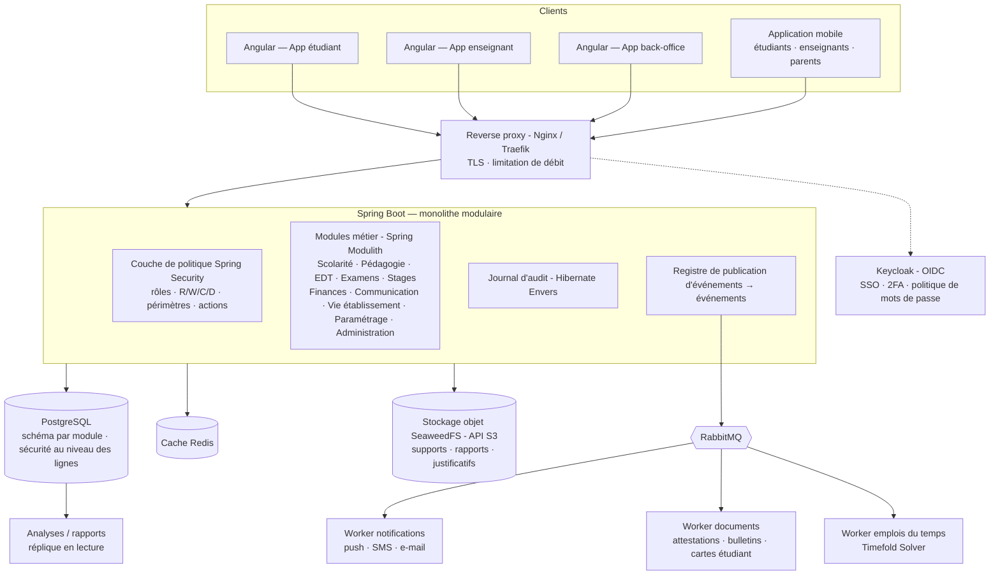

# Tekup · Educated — Rôles et fonctionnalités

**Plateforme :** Educated 7.0 (Tekup / TEK-UP University of Digital Sciences)
**Date de l'audit :** 17 novembre 2026 · année universitaire 2026-2027 (le portail étudiant affiche encore 2025-2026)
**Méthode :** parcours en lecture seule de chaque menu, écran, onglet, barre d'outils et formulaire. J'ai ouvert les formulaires pour lire leurs champs et je les ai fermés sans enregistrer. Rien n'a été créé, modifié, envoyé ni supprimé.

> **Comment lire les listes d'actions :** pour les écrans du back-office, j'indique les **boutons affichés pour ce compte** sur chaque écran. Un bouton visible signifie en général que le rôle a la permission correspondante. Je n'en ai cliqué aucun : le serveur pourrait donc encore refuser une action.

---

## 1. Vue d'ensemble — portails et rôles

| Portail | URL | Utilisateurs | Statut |
|---|---|---|---|
| **Espace étudiant** | `tekup-student`<br>`.educated.tn/etudiant/` | Étudiants<br>(même identifiant que l'app mobile) | ✅ Entièrement exploré |
| **Espace enseignant** | `tekup-teacher`<br>`.educated.tn/enseignant/` | Enseignants<br>(même identifiant partout) | ✅ Entièrement exploré |
| **Espace de gestion**<br>(back-office) | `tekup.educated.tn` | Personnel administratif,<br>accès défini par rôle | ✅ Exploré avec<br>le rôle **« Scolarité »** |
| Application mobile « Educated » | — | Étudiants, enseignants,<br>**parents / responsables** | ❌ Non disponible |
| Admin / Super Admin | `tekup.educated.tn` | Administrateurs de la plateforme | ❌ Pas encore d'identifiant.<br>Voir §5 |

### Carte des rôles

```
Étudiants .......... Espace étudiant + app mobile       (rôle fixe)
Enseignants ........ Espace enseignant + app mobile     (rôle fixe)
Parents/Responsables app mobile uniquement              (comptes créés par le personnel)
Personnel admin. ... Espace de gestion                  (rôles CONFIGURABLES)
   ├─ Super Admin .. administratif : ignore les permissions, crée les rôles
   ├─ Admin ........ utilisateurs et profils (module Administration)
   ├─ Scolarité .... rôle testé ici (21 utilisateurs, « Allow all by default »)
   └─ rôles perso .. Direction, Pédagogie, Examens, Finances, ou sur mesure
```

> Les portails étudiant et enseignant ont des fonctionnalités **fixes** (sections 2 et 3). Les accès fins et configurables concernent le **back-office**, où le Super Admin définit chaque rôle (voir §5).

---

## 2. ÉTUDIANT — Espace étudiant

Connexion : identifiant étudiant + mot de passe (les mêmes que l'application mobile Educated). Mot de passe oublié → géré par la scolarité. Il n'y a pas de réinitialisation en libre-service.

### 2.1 Fonctions globales (en-tête et compte)
| Fonction | Ce qu'elle fait |
|---|---|
| **Recherche (Ctrl K)** | Cherche dans les supports de cours, examens et messages,<br>et mène directement à n'importe quelle rubrique |
| **Bascule mode clair/sombre** | Change le thème |
| **Cloche de notifications** | Nombre de non lues, lien vers la page Notifications |
| **Profil (nom dans l'en-tête)** | Ouvre *Mon profil* |
| **Barre inférieure (mobile)** | Accueil · Agenda · Notes · Messages · Plus |

### 2.2 Accueil
- Date, numéro de semaine, semestre, message d'accueil.
- **Cours du jour**, ou « Pas de cours aujourd'hui » s'il n'y en a pas.
- Statistiques **« Ma semaine »** : séances passées, absences, supports déposés, messages non lus (scolarité et discussions), épreuves de la semaine.
- **À faire** (liste de tâches), par ex. « Vous êtes à jour ».
- **Prochain examen** (prochain examen publié), avec un lien vers le calendrier.
- **Nouveau depuis 7 jours** : actualités récentes.
- Raccourcis : **Ma carte étudiant**, **Écrire à la scolarité**.

### 2.3 Ma scolarité
| Rubrique | Consultation | Actions |
|---|---|---|
| **Emploi du temps** | Emploi du temps de la classe.<br>Signale les séances où<br>l'enseignant est absent | Semaine précédente/suivante,<br>Aujourd'hui<br>Vues Semaine / Jour / Liste<br>Mode compact |
| **Supports et programmes** | Supports de cours déposés<br>par les enseignants, et<br>programmes des matières | Changer d'onglet<br>Ouvrir / télécharger |
| **Notes** | Notes publiées par période | Choisir un semestre (S1 / S2) |
| **Examens** | Examens publiés par période.<br>La salle s'affiche dès<br>qu'elle est publiée | Choisir un semestre |
| **Absences** | Séances et heures manquées,<br>matières concernées,<br>matières à risque.<br>Taux par matière :<br>**à risque ≥ 10 %, critique ≥ 25 %**.<br>Seuls les appels confirmés par<br>l'enseignant comptent. Les séances<br>où l'enseignant était absent<br>ne comptent pas | Justifier une absence<br>en écrivant à la scolarité<br>avec un justificatif |
| **Mon stage** | Titre, numéro, année, entreprise,<br>dates, encadrants académique<br>et professionnel.<br>**Étapes :** En cours d'approbation<br>→ Approuvé → Demande de<br>soutenance → Autorisé par<br>l'encadrant → Autorisé à soutenir.<br>**Soutenance :** date, heure, salle,<br>session, jury (Président /<br>Rapporteur / Membre).<br>Stages précédents (Validé) | **Ajouter un stage**<br>**Déposer** le rapport et<br>l'attestation (verrouillés<br>une fois la soutenance<br>autorisée)<br>**Télécharger** les fichiers<br>**Demander une soutenance**<br>dans une session |

### 2.4 Échanges
| Rubrique | Ce que l'étudiant peut faire |
|---|---|
| **Messages**<br>(avec la scolarité) | Boîte de réception, envoyés, recherche.<br>**Écrire à la scolarité** : objet*, message,<br>pièce jointe facultative (≤ 20 Mo) |
| **Discussions** | Discuter avec **ses enseignants et camarades** :<br>*Nouvelle conversation* |
| **Notifications** | Toutes / Non lues. Ouvrir une notification la marque<br>comme lue et affiche l'élément concerné. Les mêmes<br>notifications arrivent sur l'application mobile |
| **Actualités** | Annonces et événements de l'établissement<br>(élections, journées portes ouvertes, cours…),<br>avec pièces jointes |

### 2.5 Démarches
| Rubrique | Ce que l'étudiant peut faire |
|---|---|
| **Demandes de documents** | **Nouvelle demande** : choisir un document, indiquer<br>un motif, joindre un justificatif facultatif<br>(PDF/JPG/PNG ≤ 5 Mo).<br>Statut : **Déposée** → **En traitement** →<br>**Traitée** (document prêt, à retirer à la scolarité) |
| Documents disponibles | • Attestation d'inscription : anglais / arabe / français<br>• Attestation de présence : anglais / arabe / français<br>• Attestation de paiement : anglais / français<br>• Attestation de diplôme<br>• Attestation de réussite<br>• Relevé des notes |
| **Paiements** | **Désactivée** (« Cette rubrique est<br>actuellement désactivée ») |

### 2.6 Mon profil (compte et profil)
- **Carte étudiant** de l'année en cours : nom, matricule, formation, niveau, classe. **Imprimer ou enregistrer en PDF**. Un QR code de vérification est annoncé « plus tard ».
- **Mes informations** : nom, matricule, formation, niveau, classe, identifiant, établissement. **Lecture seule** : toute erreur doit être signalée à la scolarité.
- **Apparence** : Système / Clair / Sombre.
- **Changer de mot de passe** : mot de passe actuel, nouveau mot de passe (≥ 6 caractères), confirmation. Il change aussi celui de l'application mobile.
- **Se déconnecter**.

---

## 3. ENSEIGNANT — Espace enseignant

Connexion : même identifiant que le portail de gestion et l'application mobile. Mot de passe oublié → scolarité.

### 3.1 Fonctions globales (en-tête et compte)
| Fonction | Ce qu'elle fait |
|---|---|
| Bascule mode clair/sombre | Thème |
| **Cloche de notifications** | Nombre de non lues, lien vers la page Notifications |
| Nom et **Se déconnecter** | Déconnexion |
| ⚠️ **Pas de page profil<br>ni de mot de passe** | `/enseignant/profil` renvoie « Cette page n'existe pas ».<br>Le portail web enseignant ne permet pas<br>de changer son mot de passe |

### 3.2 Accueil
- **Frise de la journée** : chaque séance avec l'état de son appel (« 4 / 4 appels faits »).
- **Séances du jour** (matière, classe, salle, type) avec **Voir l'appel**.
- Résumé **Stages et soutenances** : stages encadrés, rapports déposés, **sujets à approuver**, **soutenances à autoriser**, prochain jury (date, salle, rôle, nombre de soutenances).
- **À faire** : grilles de notes ouvertes, messages non lus (y compris de l'administration).
- **Prochaines surveillances**.
- Aperçu des **Messages**.
- Raccourcis : **Déposer un support**, **Écrire à l'administration**.

### 3.3 Mon travail
| Rubrique | Consultation | Actions |
|---|---|---|
| **Emploi du temps** | Vue semaine de toutes les<br>séances, avec totaux (séances,<br>heures, appels à faire) et état<br>de chaque séance (Appel fait /<br>Non confirmé) | Filtrer par classe<br>Vue Semaine / Liste<br>Mode compact<br>Semaine précédente/suivante |
| **Appels** | 14 derniers jours :<br>• **À faire**<br>• **Délai dépassé** (s'adresser<br>à la scolarité)<br>• **Faits** | Marquer chaque étudiant<br>**Présent / Absent / Retard**,<br>puis confirmer.<br>**Modifier l'appel**<br>jusqu'à un délai,<br>environ le lendemain |
| **Supports de cours** | Toutes les matières et classes<br>enseignées, avec le nombre<br>de supports pour chacune | **Déposer un support** :<br>titre*, type (Cours, DS,<br>Examen, Projet, Quiz,<br>TD, TP), description,<br>fichier (≤ 50 Mo) |
| **Saisie des notes** | Grilles de notes par matière ×<br>classe × épreuve (Projet,<br>Test, PFE…), avec grilles<br>à saisir et notes manquantes | **Note sur 20** ou **motif** :<br>Absence justifiée,<br>Absence non justifiée,<br>Dispensé(e), Fraude.<br>**Enregistrer** (brouillon)<br>**Confirmer la grille** |
| **Stages et soutenances** | **Mes stagiaires** : par session,<br>année et statut (À traiter,<br>En cours, Autorisés, Refusés).<br>Détail : sujet, entreprise,<br>encadrant, dates, objectifs,<br>état du rapport | **Approuver le sujet**<br>**Autoriser la soutenance**<br>(sur les dossiers<br>« À traiter ») |
| | **Mes jurys** : chaque jury<br>(date, salle, rôle), ses<br>soutenances et la note finale<br>une fois validée | **Consultation seule** :<br>la scolarité saisit et publie<br>les notes de soutenance |
| **Surveillances** | Surveillances d'examen à venir.<br>Seuls les plannings publiés<br>par la scolarité apparaissent | Afficher les surveillances<br>passées |
| **Messages** | **Établissement** : messages reçus<br>et envoyés avec l'administration.<br>**Conversations** : discussions<br>avec étudiants et collègues | **Écrire à l'administration** |
| **Notifications** | Filtres : Toutes, Non lues,<br>Appels, Stages, Surveillances,<br>Établissement, Conversations,<br>Autres | **Tout marquer comme lu**,<br>Ouvrir.<br>Synchronisées avec le mobile |

---

## 4. PERSONNEL ADMINISTRATIF — Espace de gestion (rôle « Scolarité »)

Le compte testé sur `tekup.educated.tn` a le rôle **« Scolarité »**. C'est un rôle configuré, pas un rôle fixe : ce qui suit décrit ce que **la configuration de ce rôle** permet. Ses réglages réels, lus dans l'éditeur de rôles :

| Réglage | Valeur pour « Scolarité » |
|---|---|
| Is Administrative /<br>Can Edit Model | Non / Non |
| **Permission Policy** | **Allow all by default**<br>(tout ce qui n'est pas explicitement interdit est autorisé) |
| **Modules visibles**<br>(6 sur 10) | ✅ Scolarité, Pédagogie, Emplois du temps, Stages,<br>Vie de l'établissement, Communication<br>❌ Examens et notes, Finances, Paramétrage,<br>Administration |
| **Type Permissions**<br>(règles explicites) | **Delete = Deny** sur Cycle, Site, Nature de stage,<br>Filière, Emploi de temps, Apprenant, Programme<br>des séances, Enseignant, Plan d'étude, Niveau, Classe<br>**Read = Allow** sur Fiche de présence<br>**Write = Allow** sur Plan d'étude |
| **Navigation Permissions**<br>(menus interdits) | Administration, Cantine, Contrôle d'accès, Evaluation,<br>Billets d'entrée, Opérations billets d'entrée, Exclus,<br>Infirmerie, Fiches de présence, Paiements |
| **Denied Actions** | « Passer en mode conception » |
| Utilisateurs de ce rôle | 21 comptes, dont plusieurs enseignants |

Comme la politique est *Allow all by default* avec seulement quelques interdictions explicites, ce rôle accède aux 5 modules métier ci-dessous et voit les boutons de création et de modification presque partout. La suppression est bloquée sur les données de référence listées ci-dessus.

Connexion : nom d'utilisateur + mot de passe + **code de vérification 2FA** (la page de connexion contient un champ 2FA).

### 4.1 Fonctions globales (en-tête, compte et réglages)
| Fonction | Ce qu'elle fait |
|---|---|
| **Sélecteur de module**<br>(en haut à gauche) | Fiches récentes, changer de module (chacun avec<br>son nombre d'alertes), rechercher un écran<br>ou un apprenant |
| **Recherche globale (Ctrl K)** | « Rechercher partout dans Educated… » |
| **Sélecteur d'année** | Changer l'année de travail (par ex. 2026-2027) |
| **Sélecteur d'établissement** | « TEK-UP » : changer d'établissement |
| **Cloche de notifications** | Toutes / Non lues, **Tout marquer comme lu**,<br>*Voir toutes les notifications*, **Réglages** |
| Page **Mes notifications** | Filtres : Toutes, Non lues, **Points d'attention,<br>Demandes, Messages reçus, Actualités**.<br>**Réglages** : activer ou couper chaque type.<br>Envoi par e-mail « à venir ».<br>**Ne pas déranger** (désactivé / activé /<br>plage horaire quotidienne) |
| **Engrenage (réglages)** | **Densité d'affichage** (Compact…) |
| **Mon compte →<br>Mes informations** | Sa propre fiche utilisateur : 2FA activé,<br>Force Password Change, User Name, Is Active.<br>Onglets : *Message From Users*,<br>*Message To Users*, *Roles*.<br>Boutons : **Enregistrer**, **Activer le 2FA**,<br>**Changer mon mot de passe** |
| **Mon compte →<br>Se déconnecter** | Déconnexion |
| **Favoris** | Épingler n'importe quel écran du menu avec ☆ |
| **Bulle de discussion**<br>(en bas à droite) | Discussions internes du personnel |
| **Tous les écrans de liste** | Filtres, regroupement, choix des colonnes,<br>**🤖 Recherche intelligente** (recherche par IA),<br>recherche texte, **Exporter vers** (CSV…),<br>actualiser, navigation entre fiches |

### 4.2 Accueil — Tableau de bord
- « *Bonjour …, N points à traiter* », filtrable par **à traiter / critiques / à surveiller / infos**, avec un bouton **Commencer** qui les parcourt dans l'ordre.
- Cartes d'état par domaine : Scolarité, Pédagogie, Emplois du temps, Stages, Vie de l'établissement, Communication.
- Indicateurs le jour de l'audit : **apprenants actifs** (2 985 dans 102 classes), **enseignants actifs** (182), **taux d'absence** (33,8 % pour un seuil de 25 %), **appels faits** (94 %).
- Points du **jour** : séances sans enseignant, appels non faits, conflits de salle, préinscriptions à étudier, séances faites à valider, séances annulées sans rattrapage, demandes de stage à approuver, rapports non déposés, apprenants au-delà de 25 % d'absence, absents du jour dont les parents n'ont pas été prévenus, demandes de rattrapage, séances sans enseignant ou sans salle, demandes de documents en attente, messages non lus des enseignants et des apprenants.

### 4.3 Module SCOLARITÉ
| Écran | Actions visibles |
|---|---|
| Tableau de bord | Tableau de bord du module |
| **Apprenants →**<br>Apprenants actifs /<br>Liste détaillée /<br>Tous les apprenants | **Nouvel apprenant**, Imprimer/Rapports (dont la fiche<br>**« Accès Etudiant »**), **Export CSV**, **Inscription**,<br>**Tarification** (frais d'un apprenant),<br>**Historique d'affectation**,<br>**Message aux parents**, **Message aux apprenants**,<br>Process |
| **Apprenants →**<br>Responsables | Créer / modifier / supprimer, **Corriger GSM**,<br>**Générer login et mot de passe** (comptes parents),<br>**Message aux responsables**, Vue, Process |
| **Apprenants →**<br>Fratries | Modifier, supprimer |
| **Apprenants →**<br>Liens de parenté | Créer / modifier / supprimer<br>(types de lien : Père, Mère, Tuteur…) |
| **Inscriptions →**<br>Demandes de<br>préinscription | Créer / modifier / supprimer,<br>**Valider préinscription**, Process |
| **Inscriptions →**<br>Historique d'affectation | Créer / modifier / supprimer (affectations aux classes) |
| **Assiduité →**<br>Pilotage des absences | Période : semaine / mois / semestre / année / dates.<br>Filtres : niveau, classe, matière, nature.<br>Indicateurs : taux d'absence, apprenants au-delà<br>de 25 %, couples classe × matière au-delà, retards,<br>fiabilité des appels.<br>Évolution par semaine, par niveau, par classe,<br>apprenants au-delà du seuil avec **Récap**. **Exporter** |
| **Assiduité →**<br>Absences | Créer / modifier / supprimer, Imprimer / Rapports,<br>**Export CSV** (lignes de fiches de présence<br>groupées par date, heure, classe) |
| **Assiduité →**<br>Demandes d'absence | Créer / modifier / supprimer, Export CSV |
| **Assiduité →**<br>Sanctions | Créer / modifier / supprimer, **Envoyer notification**,<br>Process |
| **Demandes de documents** | Nouvelle demande, **Changer le statut**<br>(Ouvert → … → Traité), modifier. Pas de suppression |
| **Éditions →**<br>Registres (présence /<br>inscription) | Créer / modifier / supprimer<br>(historique d'impression des fiches) |

### 4.4 Module PÉDAGOGIE
| Écran | Actions visibles |
|---|---|
| Tableau de bord | Tableau de bord du module |
| **Plans d'étude** (52) | Créer / cloner / modifier. Process :<br>**Générer bulletin des notes**,<br>**Valider affectations**, **Générer fiches de notes**,<br>**Générer affectation des appréciations**,<br>**Générer grilles de décisions de classes** |
| **Matières** | Créer / modifier / supprimer |
| **Enseignants →**<br>Enseignants (182) | Créer, modifier, **Envoyer l'accès par e-mail**,<br>Imprimer / Rapports, **Générer fiche de vœux**<br>(matière / emploi du temps), **Générer rapport<br>de présence**, **Générer login et mot de passe**,<br>*Inverser nom et prénom*, **Envoie un message**.<br>Pas de suppression |
| **Enseignants →**<br>Fiches de charge | Créer / cloner / modifier / supprimer,<br>**Générer grille de saisie**, Process |
| **Enseignants →**<br>Répartition des matières | Créer / modifier / supprimer |
| **Enseignants →**<br>Vœux matières /<br>Vœux emploi du temps | Créer / modifier / supprimer |
| **Enseignants →**<br>Spécialités | Créer / modifier / supprimer |
| **Suivi des cours →**<br>Présence des enseignants | Créer / modifier / supprimer, **Payer**,<br>**Annuler paiements** (paiement des heures) |
| **Suivi des cours →**<br>États d'avancement | Créer / modifier / supprimer |
| **Suivi des cours →**<br>Programmes<br>d'enseignement | Créer / **cloner** / modifier / supprimer |
| **Suivi des cours →**<br>Cahier de texte | Créer / modifier / supprimer,<br>**Opérations → Confirmer cahier de textes** |
| **Suivi des cours →**<br>Devoirs | Créer / modifier / supprimer, **Opérations → Confirmer** |
| **Suivi des cours →**<br>Supports de cours | Créer / modifier / supprimer |
| **Suivi des cours →**<br>Charge par matière | Créer / cloner / modifier / supprimer<br>(affectation des enseignants par matière) |
| **Demandes →**<br>Séances de rattrapage | Créer / modifier / supprimer,<br>**Process → Opérations → Confirmer** |
| **Demandes →**<br>Rendez-vous | Créer / modifier / supprimer (rendez-vous enseignants) |
| **Demandes →**<br>Créneaux de rendez-vous | Créer / modifier / supprimer (créneaux des enseignants) |
| **Observations** | Créer / modifier / supprimer (journal d'observations) |
| **Formation continue** | Créer / modifier / supprimer |

### 4.5 Module EMPLOIS DU TEMPS
| Écran | Actions visibles |
|---|---|
| Tableau de bord | Tableau de bord du module |
| **Emplois du temps** | Créer, Imprimer / Rapports, **Export**,<br>**Générer (Optimisé)** (emploi du temps automatique),<br>ouvrir le planning, Process |
| **Contrôle des créneaux** | Créneaux à corriger : **conflits de salle**,<br>**sans enseignant**, **sans salle**, *hors contrôle*.<br>Regrouper par classe, enseignant ou salle.<br>Cette semaine ou tout l'emploi du temps.<br>Corrections : **déplacer** un créneau, **changer<br>de salle**, **marquer « hors contrôle »**.<br>Ouvrir dans le calendrier |
| **Programmes des séances** | Créer |
| **Règles pédagogiques** | Créer / modifier / supprimer |
| **Calendrier universitaire** | Créer / modifier / supprimer, **Exporter calendrier**,<br>Process |

### 4.6 Module STAGES
| Écran | Actions visibles |
|---|---|
| Tableau de bord | Tableau de bord du module |
| **Demandes de stage** | Créer, supprimer, **Approuver**, **Refuser**,<br>**Autoriser par l'encadrant**, **Autoriser à soutenir**,<br>**Rouvrir le dossier**, **Rattacher l'encadrant**,<br>modifier, Imprimer / Rapports |
| **Soutenances** | Créer / modifier / supprimer, **Publier / Dépublier**,<br>**Valider la note**, Imprimer / Rapports |
| **Jurys** | Créer / modifier / supprimer, Imprimer / Rapports |
| **Sessions de soutenance** | Créer / modifier / supprimer, Imprimer / Rapports |
| **Entreprises d'accueil**<br>(989) | Créer / modifier / supprimer |
| **Encadrants<br>professionnels** | Créer / modifier / supprimer |

### 4.7 Module COMMUNICATION
| Écran | Ce qu'il fait |
|---|---|
| Tableau de bord | Tableau de bord du module |
| **Messages reçus** | Messages des **apprenants, parents et enseignants**<br>(90 derniers jours), filtre par public,<br>non lus seulement, recherche |
| **Messages envoyés** | Messages envoyés |
| **Nouveau message** | Public : **Apprenants / Parents / Enseignants**.<br>Destinataires : individuels ou groupes (**tous**,<br>**par niveau**, **par classe**). Objet, texte mis en<br>forme, texte de notification/SMS (160 caractères).<br>Envoi en **notification sur l'application**, **SMS**,<br>et option **prévenir aussi les parents**.<br>**Joindre un fichier** |
| **Discussions internes** | Messagerie réservée au personnel :<br>**Nouvelle** (collègue ou groupe) |
| **Mes notifications** | Voir §4.1 |
| **Chat enseignants –<br>apprenants** | Créer / modifier / supprimer<br>(modération des conversations) |
| **Actualités** | **Nouvelle actualité** : publiée dans les applications<br>des apprenants, parents et enseignants.<br>Filtre : notifiées / pas encore notifiées |
| **Notifications envoyées** | Volume, destinataires et **taux de lecture** par période,<br>public et type (Absence, Message, Actualité,<br>Document, Discussion). Graphique par jour.<br>Destinataires sans l'application installée |
| **Demandes des<br>responsables** | Créer / modifier / supprimer<br>(*Prise RDV* : demandes de rendez-vous des parents) |

---

## 5. SUPER ADMIN ET RÔLES CONFIGURABLES (l'éditeur de rôles)

Les rôles du back-office ne sont pas figés. Le **Super Admin** crée les rôles et décide, pour chacun, quelles rubriques sont visibles et quelles actions sont permises : lecture seule, lecture et écriture, contrôle total, ou masqué. Le rôle « Scolarité » du §4 en est un exemple.

> L'éditeur de rôles ci-dessous a été **lu directement** dans la fiche du rôle « Scolarité » (ouverte depuis *Mon compte → Mes informations → Roles*). Je n'ai rien modifié ni enregistré. Les écrans propres au Super Admin (liste des rôles, module Administration) n'ont pas encore été vus : les points correspondants sont marqués *(à vérifier)*.

### 5.1 Ce que fait le Super Admin
| Domaine | Capacités |
|---|---|
| **Rôles (profils)** | Créer (*Nouveau Role*), modifier, cloner, supprimer.<br>Définir modules, politique par défaut, droits<br>par entité, accès par menu et actions interdites (§5.2) |
| **Utilisateurs** | Créer des utilisateurs, les lier ou délier à des rôles<br>(*Lier / Dissocier*), activer/désactiver, forcer<br>le changement de mot de passe, activer le 2FA |
| **Rôle administratif** | *Is Administrative* : accès complet qui **ignore toutes<br>les permissions** (« Permissions are customizable and<br>apply only to non-Administrative roles ») |
| **Modification du modèle** | *Can Edit Model* : personnaliser l'application elle-même<br>(mises en page, vues, *Passer en mode conception*) |
| **Paramétrage**<br>*(à vérifier)* | Référentiels : cycles, sites, filières, niveaux,<br>classes, natures de stage… |
| **Administration**<br>*(à vérifier)* | « utilisateurs, profils, système » |
| **Multi-établissement**<br>*(à vérifier)* | Sélecteur d'établissement (TEK-UP) dans l'en-tête :<br>un Super Admin couvre probablement plusieurs<br>établissements |

**Admin ou Super Admin** *(à vérifier)* : le Super Admin est très probablement un rôle *Is Administrative + Can Edit Model*. Un Admin est soit administratif sans modification du modèle, soit un rôle non administratif disposant du module Administration pour gérer utilisateurs et profils.

### 5.2 Anatomie d'un rôle (telle que vue dans l'éditeur)

Un rôle comporte 6 couches. La visibilité (couche 2) et l'accès aux données (couches 3 à 6) sont **séparés** : l'éditeur l'indique, « *Ce choix règle ce que les utilisateurs du profil voient. L'accès aux données reste celui des permissions ci-dessous* ».

| # | Couche | Ce qu'elle contrôle | Options |
|---|---|---|---|
| 1 | **Identité** | Nom, *Is Administrative*,<br>*Can Edit Model* | Texte, cases à cocher |
| 2 | **Modules<br>visibles** | Lesquels des 10 modules<br>apparaissent (menu, accueil,<br>alertes) | Activé/désactivé par module.<br>Choix rapides : **Direction,<br>Scolarité, Pédagogie,<br>Examens, Finances** |
| 3 | **Permission<br>Policy** | Valeur par défaut pour tout<br>ce qui n'est pas listé | **Deny all** / **Read only all** /<br>**Allow all** by default |
| 4 | **Type<br>Permissions** | Droits sur chaque entité<br>(Apprenant, Classe…) | **Read / Write / Create / Delete** :<br>*Allow*, *Deny* ou vide (hérité) |
| 5 | **Navigation<br>Permissions** | Accès à chaque entrée<br>de menu | **Navigate** : *Allow* / *Deny* |
| 6 | **Denied<br>Actions** | Masquer des boutons même<br>quand les données sont<br>autorisées | ex. *Payer*, *Valider la note*,<br>*Publier*, *Supprimer* |
| + | **Users** | Qui a ce rôle. Les droits<br>de plusieurs rôles se cumulent | Lier / délier des utilisateurs<br>*(règle de cumul à vérifier)* |

*(à vérifier)* Le framework utilisé (DevExpress XAF, d'après les noms d'écrans) permet aussi des **permissions au niveau des lignes** (ex. « uniquement les classes de mon département ») et **au niveau des champs** (ex. « voir un apprenant mais pas ses frais ») dans chaque permission de type. À confirmer en ouvrant une ligne de permission avec un compte Super Admin.

### 5.3 Les 10 modules attribuables à un rôle
| Module | Contenu (description de l'éditeur) | Vu dans cet audit |
|---|---|---|
| Scolarité | inscriptions, apprenants, assiduité | §4.3 |
| Pédagogie | plans d'étude, séances, appels | §4.4 |
| Emplois du temps | créneaux, salles, conflits | §4.5 |
| **Examens et notes** | sessions, grilles, bulletins | ❌ non activé |
| Stages | demandes, conventions, soutenances | §4.6 |
| **Finances** | échéances, paiements, relances | ❌ non activé |
| Vie de l'établissement | actualités, sondages, services | carte du tableau de bord seulement |
| Communication | messages, actualités, notifications | §4.7 |
| **Paramétrage** | référentiels de l'établissement | ❌ non activé |
| **Administration** | utilisateurs, profils, système | ❌ non activé |

La liste des permissions de navigation révèle aussi **d'autres écrans** de la plateforme, attribuables ou interdits par rôle : **Cantine**, **Contrôle d'accès**, **Billets d'entrée / Opérations billets d'entrée**, **Exclus**, **Infirmerie**, **Evaluation**, **Fiches de présence**, **Paiements**.

### 5.4 Comment configurer chaque niveau d'accès
| Accès souhaité | Configuration |
|---|---|
| **Masqué** | Module désactivé + *Navigate = Deny* sur ses écrans et,<br>si la politique n'est pas Deny-all, *Read = Deny* sur<br>ses entités. Masquer le menu ne bloque pas les données |
| **Lecture seule** | *Read = Allow*, *Write / Create / Delete = Deny*.<br>Ou politique **Read only all by default** + écriture<br>accordée seulement là où il faut |
| **Lecture + modification,<br>sans création ni suppression** | *Read / Write = Allow*, *Create / Delete = Deny* |
| **Contrôle total** | *Read / Write / Create / Delete = Allow* |
| **Tout sauf une action<br>sensible** | Autoriser les données + ajouter le bouton aux<br>**Denied Actions** (ex. *Payer*, *Valider la note*,<br>*Publier*) |
| **Uniquement son périmètre**<br>*(à vérifier)* | Critères au niveau des lignes (département,<br>classe, site) |
| **Masquer des champs<br>sensibles** *(à vérifier)* | Permission au niveau des champs<br>(frais, numéros de téléphone…) |

> **Bonne pratique :** partir de **Deny all by default** pour tout rôle non administratif et accorder explicitement (moindre privilège). Le rôle « Scolarité » actuel fait l'inverse (*Allow all by default*), c'est pourquoi il peut faire bien plus que ce que son nom laisse penser.

### 5.5 Rôles types (proposition)
Les 5 choix rapides existent dans l'éditeur. Leurs permissions exactes n'étaient pas visibles : les droits ci-dessous sont une **base recommandée**, pas la configuration actuelle.

| Rôle | Modules visibles | Droits sur les données (recommandés) |
|---|---|---|
| **Super Admin** | Les 10 | *Is Administrative* + *Can Edit Model* |
| **Admin** | Administration,<br>Paramétrage +<br>lecture sur le reste | Tout sur utilisateurs, rôles, référentiels.<br>Lecture seule sur les données métier.<br>Ne peut pas modifier le modèle |
| **Direction**<br>(choix rapide) | Tous les modules<br>métier | **Read only all by default**,<br>plus tableaux de bord et exports |
| **Scolarité**<br>(choix rapide, existe) | Scolarité,<br>Communication,<br>Stages (lecture) | Tout sur apprenants, responsables,<br>inscriptions, absences, sanctions,<br>demandes de documents. Lecture sur<br>Pédagogie / emplois du temps.<br>Interdire *Payer*, *Tarification* |
| **Pédagogie**<br>(choix rapide) | Pédagogie,<br>Emplois du temps | Tout sur plans d'étude, enseignants,<br>charges, suivi des cours, rattrapages.<br>Lecture sur les apprenants.<br>Interdire *Payer* (enseignants) |
| **Examens**<br>(choix rapide) | Examens et notes,<br>Stages (soutenances) | Tout sur sessions d'examen, grilles,<br>bulletins, notes de soutenance.<br>Seul rôle avec *Valider la note*<br>et *Publier* |
| **Finances**<br>(choix rapide) | Finances,<br>Scolarité (lecture) | Tout sur frais, paiements, relances,<br>paiement des heures enseignants.<br>Seul rôle avec *Payer* et<br>*Annuler paiements* |
| **Bureau des stages**<br>(exemple) | Stages,<br>Scolarité (lecture) | Tout sur stages, jurys, sessions,<br>entreprises, encadrants |
| **Communication**<br>(exemple) | Communication | Tout sur actualités, messages groupés<br>et SMS. Lecture sur apprenants<br>et responsables |
| **Auditeur**<br>(exemple) | Tous | **Read only all by default**.<br>Toute action d'écriture interdite |

### 5.6 Modèle de matrice de permissions
Une colonne par rôle (R = lecture, W = modification, C = création, D = suppression, — = masqué). Exemple pour un rôle « Direction » en lecture seule et pour le rôle « Scolarité » actuel :

| Rubrique / entité | Direction<br>(proposé) | Scolarité<br>(actuel) | Nouveau rôle |
|---|---|---|---|
| Apprenants | R | R W C — (pas de D) | |
| Responsables | R | R W C D | |
| Inscriptions / préinscriptions | R | R W C D | |
| Absences / fiches de présence | R | R W C D ¹ | |
| Sanctions | R | R W C D | |
| Demandes de documents | R | R W C | |
| Plans d'étude | R | R W C — | |
| Enseignants | R | R W C — | |
| Présence et paie enseignants | R | R W C D + *Payer* | |
| Emplois du temps | R | R W C — | |
| Examens et notes | R | masqué, données<br>autorisées ² ⚠️ | |
| Stages / soutenances | R | R W C D | |
| Finances | R | masqué, données<br>autorisées ² ⚠️ | |
| Communication | R | R W C D | |
| Paramétrage (référentiels) | — | partiel, pas de D ³ | |
| Administration (utilisateurs, rôles) | — | — ⚠️ voir §7.2 | |

¹ La lecture est autorisée explicitement, le reste vient de la politique. Le menu « Fiches de présence » est interdit.
² Le module est masqué (et le menu « Paiements » interdit), mais la politique « Allow all » autorise quand même les données.
³ La suppression est interdite sur les entités de référence (Cycle, Site, Filière, Niveau, Classe…).

### 5.7 Rôles hors personnel
| Rôle | Fonctions | Indices |
|---|---|---|
| **Parent / Responsable**<br>(application mobile) | Reçoit les alertes d'absence,<br>messages, actualités. Écrit à<br>l'établissement. **Prend<br>rendez-vous** avec les enseignants | Génération des comptes parents,<br>*Prévenir aussi les parents*,<br>*Demandes des responsables*,<br>*Créneaux de rendez-vous* |
| **Encadrant professionnel**<br>(entreprise) | Enregistré comme donnée<br>des stages. Aucun portail vu | Liste *Encadrants<br>professionnels* |

---

## 6. Processus transverses

La colonne « Back-office » décrit ce que chaque processus implique côté administration. Le rôle du personnel qui réalise chaque étape dépend de la configuration des rôles par le Super Admin (§5).

| Processus | Étudiant | Enseignant | Back-office |
|---|---|---|---|
| **Assiduité** | Voit ses absences<br>et taux par matière.<br>Justifie par message | Fait l'appel<br>(Présent / Absent / Retard)<br>et le confirme. Peut le<br>modifier jusqu'au délai | Pilotage des absences,<br>appels non faits,<br>demandes d'absence,<br>prévient les parents |
| **Notes** | Voit les notes publiées<br>par semestre | Remplit les grilles<br>(note ou motif),<br>enregistre, **confirme** | Génère les grilles,<br>bulletins et grilles<br>de décisions |
| **Supports de cours** | Consulte, télécharge | Dépose (≤ 50 Mo) | Gère supports<br>et programmes |
| **Stage / PFE** | Le déclare, dépose<br>rapport + attestation,<br>demande la soutenance,<br>voit jury et date | Approuve le sujet,<br>autorise la soutenance,<br>siège aux jurys<br>(consultation seule) | Approuve / refuse,<br>constitue jurys et<br>sessions, **saisit, valide<br>et publie les notes<br>de soutenance** |
| **Demandes de documents** | Demande l'un des<br>11 documents,<br>suit le statut | — | Change le statut<br>(Ouvert → Traité) |
| **Emploi du temps** | Le consulte | Le consulte, état<br>des appels par séance | Génère (optimisé),<br>corrige les conflits,<br>règles, calendrier |
| **Rattrapages** | — | Demande des rattrapages | Les confirme |
| **Surveillances d'examen** | Voit examens et salles<br>une fois publiés | Voit ses surveillances<br>une fois publiées | Publie les plannings |
| **Messagerie** | Écrit à la scolarité,<br>discute avec<br>enseignants et camarades | Écrit à l'administration,<br>discute | Messages groupés, SMS,<br>notifications, actualités,<br>statistiques d'envoi |

---

## 7. Constats et points à vérifier

1. **Le rôle « Scolarité » est trop permissif par configuration.** Sa politique est *Allow all by default* avec seulement 11 interdictions de suppression : il peut donc créer et modifier presque tout, y compris le paiement des heures des enseignants (*Payer*) et la génération des identifiants des enseignants et des parents. Masquer un module (Examens, Finances) ne masque que le menu. **Correction :** passer à *Deny all by default* ou *Read only all by default* et accorder explicitement.
2. **⚠️ Élévation de privilèges possible (à vérifier en priorité).** Depuis *Mon compte → Mes informations → Roles*, le compte Scolarité peut **ouvrir l'éditeur de son propre rôle**. Il y voit **Enregistrer, Supprimer, Nouveau Role, Lier / Dissocier des utilisateurs**, la case *Is Administrative* et le sélecteur de politique, alors que le menu « Administration » lui est interdit. Si l'enregistrement fonctionne, n'importe lequel des 21 utilisateurs pourrait rendre son rôle administratif. Je ne l'ai pas testé. **Correction :** interdire les **entités Rôle / Utilisateur / permissions** au niveau des permissions de type pour tout rôle non administratif, pas seulement le menu.
3. **Des enseignants ont un rôle de back-office.** Plusieurs des 21 utilisateurs « Scolarité » figurent dans la liste des enseignants. Avec le point 1, un compte enseignant peut accéder aux dossiers des apprenants, aux frais et au paiement des enseignants.
4. **Masquer un menu n'est pas un contrôle d'accès.** Plusieurs écrans ne sont bloqués que par les *Navigation Permissions* (ex. Administration, Paiements) ou par les modules masqués. L'accès doit aussi être interdit au niveau des *Type Permissions*.
5. **Incohérence 2FA.** La connexion demande un code 2FA, mais la fiche utilisateur indique *2FA activé = non coché*.
6. **Pas de changement de mot de passe sur le portail web enseignant.** Le portail étudiant le permet, pas le portail enseignant (aucune page profil).
7. **La rubrique « Paiements » étudiant est désactivée.**
8. **Les menus du back-office chargent lentement.** Un module peut n'afficher brièvement que « Tableau de bord » avant que le menu complet apparaisse. L'application limite aussi le nombre d'écrans ouverts en onglets.

---

## 8. Périmètre et limites
- **Exploré :** chaque entrée de menu des portails étudiant et enseignant, chaque entrée des 5 modules accessibles au compte « Scolarité », l'en-tête, le profil, les notifications et les réglages de chaque portail, et **l'éditeur du rôle** « Scolarité » (ouvert en consultation, rien enregistré).
- **Non exploré :** les comptes Admin / Super Admin et leurs écrans (liste des rôles, modules Administration, Paramétrage, Examens et notes, Finances), l'application mobile, les comptes parents. Je n'ai cliqué sur aucun bouton d'action (Approuver, Payer, Générer, Publier, Supprimer…) : la réussite effective de chaque action pour un rôle donné n'est donc pas vérifiée.
- **Exception à la lecture seule :** ouvrir la page *Messages* de l'enseignant affiche automatiquement le dernier message, ce qui peut le marquer comme lu.

---

## 9. Architecture recommandée

### 9.1 Recommandation
**Un monolithe modulaire** construit avec **Spring Boot** (back-end) et **Angular** (front-ends) : un seul back-end déployé d'un bloc, découpé en interne en modules métier stricts. On ajoute **quelques services workers séparés** uniquement pour ce qui se comporte différemment : notifications et SMS, génération de PDF et de rapports, optimisation des emplois du temps, stockage de fichiers, et un fournisseur d'identité externe (Keycloak).

**Pas de microservices complets**, du moins pas au départ. Les frontières entre modules restent nettes : un module pourra devenir un service à part plus tard si la charge ou la taille de l'équipe l'exige.

### 9.2 Pourquoi pas les microservices (pour l'instant)
| Constat | Conséquence |
|---|---|
| **Volume** : ~3 000 apprenants, ~180 enseignants,<br>~100 classes par établissement,<br>~27 000 notifications par semaine.<br>Pics au début des séances et<br>à la publication des notes | Un back-end bien dimensionné et des workers<br>asynchrones suffisent largement. Les microservices<br>règlent un problème de charge qui n'existe pas ici |
| **Les domaines sont très liés.** Un appel<br>touche l'emploi du temps, les apprenants,<br>la paie, les seuils et les notifications<br>aux parents | Dans une seule base, ce sont des transactions simples.<br>Entre microservices, ce sont des sagas, risquées<br>pour les notes et les paiements |
| **Les permissions traversent tout**<br>(§5 : par entité, menu, action,<br>ligne, champ) | Une couche de politique centrale reste cohérente<br>facilement. Chaque microservice devrait la<br>réimplémenter : c'est le type de faille vu au §7 |
| **Les tableaux de bord croisent tous<br>les domaines** (accueil, pilotage des<br>absences, statistiques d'envoi) | Simple dans une seule base. Entre services, il faut<br>dupliquer et synchroniser les données |
| **Taille de l'équipe** : les microservices<br>sont rentables avec plusieurs<br>équipes indépendantes | Pour une petite ou moyenne équipe, le surcoût<br>domine (découverte de services, traçage,<br>API versionnées, CI/CD par service) |

**Quand les microservices deviendraient le bon choix :** Educated est vendu en SaaS à de nombreux établissements (le sélecteur d'établissement suggère du multi-tenant) avec des centaines de milliers d'utilisateurs, plusieurs équipes possèdent chacune leurs domaines, ou certains domaines ont besoin de livraisons indépendantes ou d'une montée en charge très différente. Le monolithe modulaire permet alors de découper module par module, le long des frontières existantes (pattern « strangler »).

### 9.3 Comparaison
| Critère | Monolithe<br>classique | **Monolithe<br>modulaire ✅** | Micro-<br>services |
|---|---|---|---|
| Rapidité, petite équipe | Élevée | **Élevée** | Faible |
| Cohérence (notes, paiements) | Facile | **Facile** | Difficile (sagas) |
| Permissions cohérentes | Facile | **Facile** | Difficile |
| Tableaux de bord transverses | Facile | **Facile** | Difficile |
| Montée en charge indépendante | Non | **En partie** (workers) | Oui |
| Déploiements indépendants | Non | Non | Oui |
| Coût et complexité d'exploitation | Faible | **Faible à moyen** | Élevé |
| Facilité à découper plus tard | Difficile | **Facile** | — |

### 9.4 Architecture cible



### 9.5 Modules (contextes métier)
| Module | Données gérées | Exemples d'événements |
|---|---|---|
| **Identité et accès**<br>(Administration) | Utilisateurs, rôles, permissions,<br>réglages 2FA | `RoleChanged`<br>`UserDeactivated` |
| **Paramétrage** | Sites, cycles, filières, niveaux,<br>classes, années, calendrier | `AcademicYearOpened` |
| **Scolarité** | Apprenants, responsables, inscriptions,<br>affectations, sanctions, documents | `StudentEnrolled`<br>`DocumentRequestStatusChanged` |
| **Pédagogie** | Plans d'étude, matières, enseignants,<br>charges, cahiers de texte, devoirs,<br>supports, rattrapages, rendez-vous | `MaterialPublished`<br>`MakeUpConfirmed` |
| **Assiduité** | Appels, lignes de présence,<br>demandes d'absence, seuils | `AbsenceRecorded`<br>`AbsenceThresholdExceeded` |
| **Emplois du temps** | Emplois du temps, créneaux, salles,<br>règles, conflits | `SessionScheduled`<br>`SessionCancelled` |
| **Examens et notes** | Sessions d'examen, grilles de notes,<br>bulletins, décisions de classe | `GradeGridConfirmed`<br>`GradesPublished` |
| **Stages** | Stages, soutenances, jurys,<br>sessions, entreprises, encadrants | `DefenseAuthorized`<br>`DefenseGradePublished` |
| **Finances** | Frais, échéances, paiements,<br>relances, paie des enseignants | `PaymentReceived`<br>`TeacherHoursPaid` |
| **Communication** | Messages, actualités, discussions,<br>centre de notifications | Consomme les événements<br>ci-dessus et les transforme<br>en notifications |
| **Vie de l'établissement** | Cantine, infirmerie, contrôle d'accès,<br>billets d'entrée, sondages | — |

**Règles :**
- Chaque module possède son propre schéma de base de données. Aucun module n'écrit dans les tables d'un autre.
- Chaque module expose un paquet `api` public et garde le reste `internal`. **Spring Modulith** le vérifie dans les tests.
- Les modules communiquent par interfaces publiques ou par événements métier, publiés via le registre de publication d'événements de Spring Modulith (outbox) : aucun événement n'est perdu.
- Les tableaux de bord lisent des modèles de lecture dédiés.

### 9.6 Conception des autorisations (le point critique, vu le §5 et le §7)
1. **Garder le modèle de rôle à 6 couches** du §5 (c'est une bonne conception, souple), mais **l'appliquer côté serveur** avec **Spring Security** : chaque endpoint et chaque requête passe par une seule couche de politique (`@PreAuthorize` + un `PermissionEvaluator` personnalisé). Ne jamais compter sur le masquage des menus.
2. **Refus par défaut** pour tout rôle non administratif.
3. **Une permission =** rôle + ressource (entité ou écran) + action (lecture / écriture / création / suppression / actions spécifiques comme *publier*, *payer*, *valider la note*) + **périmètre** (tout / établissement / département / classe / ses propres données) + **règles sur les champs** (masquer frais, téléphones…).
4. **Périmètres en base de données** (sécurité au niveau des lignes PostgreSQL ou filtres Hibernate). **Masquage des champs** dans les DTO (MapStruct).
5. **Protéger le système de permissions lui-même.** Seul le module Identité et accès modifie les rôles, et seulement avec une permission administrative. Chaque modification est tracée. L'attribution de droits administrateur peut exiger la validation d'un second Super Admin.
6. **Séparation des tâches.** Qui saisit les notes ne peut pas les publier. Qui enregistre la présence des enseignants ne peut pas la payer.
7. **Journal d'audit en ajout seul** pour les modifications de notes, les paiements, les publications, les changements de rôles et les connexions.
8. **2FA obligatoire** (Keycloak) pour tous les rôles du back-office. Changement de mot de passe forcé pour les identifiants générés. Sessions courtes au back-office.
9. **Les enseignants ayant des tâches administratives** reçoivent un rôle séparé, explicite et minimal. Ils ne partagent pas le large rôle « Scolarité ».
10. **Côté Angular**, une directive `*hasPermission` et des guards de routes **masquent** ce qu'un rôle ne peut pas faire, mais seul le serveur fait réellement barrière.

### 9.7 Stack : Angular + Spring Boot
| Couche | Choix | Pourquoi |
|---|---|---|
| **Back-end** | **Spring Boot 4.2** (Java 25)<br>+ **Spring Modulith 2.2** | Frontières de modules imposées et testées,<br>outbox intégré pour les événements |
| **Données** | Spring Data JPA (Hibernate),<br>**Flyway**, PostgreSQL | Transactions, migrations, schéma par<br>module, sécurité au niveau des lignes |
| **API** | REST + **springdoc-openapi** | La spécification OpenAPI génère<br>le client API Angular |
| **Sécurité** | **Spring Security** (resource<br>server OAuth2) + **Keycloak** | SSO sur les 3 portails + mobile,<br>2FA, politiques de mots de passe |
| **Asynchrone et tâches** | **RabbitMQ** (Spring AMQP),<br>**Spring Batch**, Quartz / JobRunr | Notifications, bulletins en masse,<br>SMS groupés, relances planifiées |
| **Emplois du temps** | **Timefold Solver**<br>(successeur d'OptaPlanner) | Fournit un modèle d'emploi du temps<br>scolaire pour *Générer (Optimisé)* |
| **Documents** | JasperReports ou Thymeleaf<br>+ OpenHTMLtoPDF, ZXing (QR) | Attestations, bulletins,<br>carte étudiant avec QR code |
| **Audit** | **Hibernate Envers**<br>+ table d'actions en ajout seul | Historique des fiches et<br>traçabilité des actions sensibles |
| **Front-end** | **Angular 22** (standalone,<br>signals) dans un **monorepo Nx 24** | 3 apps : `student`, `teacher`,<br>`backoffice` (+ PWA `parent` optionnelle) |
| **Bibliothèques front** | Angular Material ou PrimeNG,<br>angular-oauth2-oidc,<br>`api-client` généré | Design system commun (clair/sombre),<br>connexion OIDC, appels API typés |
| **Langues** | Angular i18n : FR / EN / AR | Les documents existent en arabe,<br>donc mise en page de droite à gauche |
| **Mobile** | **Ionic + Capacitor**, ou l'app<br>actuelle sur la même API | Réutilise le code Angular.<br>Notifications via FCM / APNs |
| **Fichiers** | **SeaweedFS** (API S3 ; MinIO ne<br>publie plus d'images) + antivirus | Supports ≤ 50 Mo, justificatifs, rapports |
| **Observabilité** | Actuator + Micrometer +<br>OpenTelemetry → Grafana | Métriques, traces, logs |
| **Tests** | JUnit 5, **Testcontainers**,<br>tests Modulith, ArchUnit ;<br>Jest + Playwright (Angular) | Vraie base / broker / Keycloak dans<br>les tests, règles d'architecture, E2E |
| **Hébergement** | Docker sur 2–3 VM ou conteneurs<br>managés. Kubernetes seulement<br>si le multi-tenant l'exige | Coût d'exploitation proportionné |

**Organisation suggérée du back-end**

```
educated-backend/
  src/main/java/tn/tekup/educated/
    administration/   api/  internal/
    parametrage/      api/  internal/
    scolarite/        api/  internal/
    assiduite/        api/  internal/
    pedagogie/        api/  internal/
    emploidutemps/    api/  internal/
    examens/          api/  internal/
    stages/           api/  internal/
    finances/         api/  internal/
    communication/    api/  internal/
    shared/           security/  audit/  events/
  workers/
    notification-worker/  document-worker/  timetable-worker/
```

### 9.8 Plan de migration
1. **Tout de suite :** corriger les problèmes de permissions du système actuel (§7) : refus par défaut, protection des entités rôle et utilisateur, 2FA obligatoire.
2. **Ensuite :** mettre en place **Keycloak** (SSO + 2FA) pour tous les clients, et définir les frontières des modules et les contrats OpenAPI.
3. Déplacer les **notifications** et la **génération de documents** dans des workers asynchrones : gains isolés et peu risqués.
4. Reconstruire **module par module** en Spring Boot + Angular derrière le proxy, en commençant par les flux les plus utilisés (appels, notes), et laisser chaque module prendre possession de son schéma.
5. **Réévaluer les microservices** uniquement quand le multi-tenant ou la croissance de l'équipe l'exige, en découpant le long des frontières de modules existantes.
